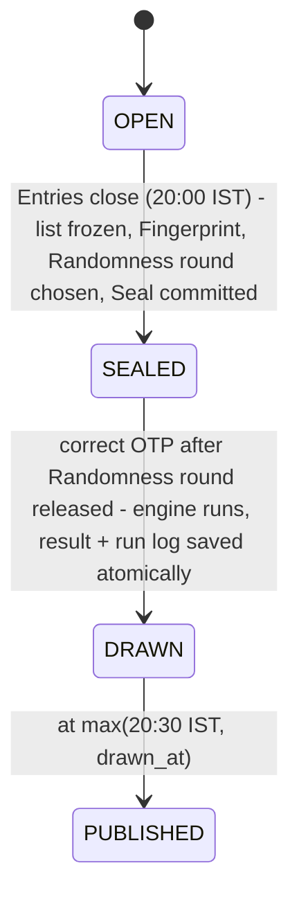

# Spec: Boche Lucky Draw – engine, backend and integration

**Status:** ready-for-agent

## Problem Statement

Boche sells tea through one customer app, and every paid tea Pack earns Tickets for a nightly lucky draw with ten Winners (three Main prizes, seven Consolation prizes) paid in real money. The existing app is a front-end-only prototype. Its draw cannot be trusted: lucky numbers are made in the browser, the Winners follow from a hash of the date (so anyone can predict them), 3,200 fake entries are mixed in, and the signed-in Customer is forced to win on their first draw days. Nothing is stored on a server, so a Customer cannot prove they entered, and nobody outside the company can check that a result was not manipulated.

Customers need confidence that their Tickets were in tonight's draw and had an equal chance. The client needs a draw that nobody (Admins, developers, or outside attackers) can rig, that gives exactly one official result per Draw day, and that outsiders can check independently. With 50,000 to 100,000 users and up to about 100,000 Tickets a day, it must also be quick.

## Solution

A backend behind the existing screens makes the flow real:

- A Customer signs in with Google, buys tea, and receives Tickets only after the server has confirmed payment (mocked).
- "Enter today's lucky draw" saves the Entry on the server.
- At 8:00 PM IST, Entries close. The day's Ticket list is published, and its Fingerprint and the chosen Randomness round are sealed in a public GitHub repository.
- From 8:15 PM, an Admin requests an OTP that goes to the Founder's mobile. The Founder passes it on, and the Admin enters it to run the draw.
- The draw uses only the inputs fixed at 8:00 PM: the sealed Ticket list and the drand Randomness round released at 8:15 PM. Every Draw run gives the same ten Winners, and every run is logged.
- Results are published at 8:30 PM, revealed with an animation personalised for each Customer.
- Each Customer sees whether each of their Tickets was included and whether it won.
- Anyone can download the day's files and run a small standalone Verifier that checks the list against the Seal, fetches the randomness from drand directly, and recomputes the Winners.
- Test mode lets reviewers run a whole Draw day on demand.

## User Stories

### Customer: sign-in and buying
1. As a Customer, I want to sign in with my Google account, so that I don't need a separate password or OTP.
2. As a Customer, I want my name and email filled in from Google, so that I don't have to type them.
3. As a Customer, I want to stay signed in when I reload or reopen the app, so that I don't sign in every visit.
4. As a Customer, I want to sign out, so that others using my phone can't see my Tickets.
5. As a Customer, I want to buy tea Packs with the same screens as before, so that the experience feels familiar.
6. As a Customer, I want the price I pay to be calculated by Boche, so that I'm charged the correct amount including GST and logistics.
7. As a Customer, I want my Scratch cards and lucky numbers to appear only after my payment succeeds, so that I know my Tickets are real.
8. As a Customer, I want my Orders, Scratch cards and lucky numbers to survive reloads and different devices, so that I never lose a Ticket.
9. As a Customer, I want each Pack to give the number of lucky numbers it advertises (250 g: 1, 500 g: 3, 1 kg: 8), so that I get what I paid for.
10. As a Customer, I want to scratch my card to reveal my lucky numbers, so that the reveal feels fun.

### Customer: entering and results
11. As a Customer, I want "Enter today's Lucky Draw" to register my Tickets on the server, so that they really take part.
12. As a Customer, I want Entries made before 8:00 PM to go into today's draw and later ones into tomorrow's, so that I know which draw I'm in.
13. As a Customer, I want to be told clearly when I'm entering tomorrow's draw because today's has closed, so that I'm not surprised.
14. As a Customer, I want to see a countdown to the results, so that I know when to come back.
15. As a Customer, I want to see the ten Winners at 8:30 PM, so that I know the result.
16. As a Customer, I want a dramatic reveal of the Winners from the 7th Consolation prize up to the 1st Main prize, so that the result feels exciting.
17. As a Customer who won, I want a personal "You won ₹X" celebration, so that the moment feels special.
18. As a Customer who didn't win, I want a kind "Better luck next time" message, so that I feel encouraged to play again.
19. As a Customer, I want to skip the reveal animation, so that I can see the results quickly.
20. As a Customer, I want the reveal to play only once per day on my device, so that it doesn't repeat every time I open the screen.
21. As a Customer, I want to see, for each of my Tickets, whether it was included in tonight's sealed list, so that I know it counted.
22. As a Customer, I want to see which of my Tickets won and what they won, so that I can Claim my prize.
23. As a Customer, I want Winners shown with a masked name and mobile number, so that winners' privacy is protected.
24. As a Customer, I want to submit a Claim for a Winner Ticket, so that I can be paid.
25. As a Customer, I want to be unable to Claim a Ticket that didn't win, so that the claims process is trustworthy.
26. As a Customer, I want to browse the last 30 days' results, so that I can see past Winners.
27. As a Customer, I want a "Verify this draw" link next to the results, so that I can check the draw was fair.

### Admin
28. As an Admin, I want to sign in with Google on the staff sign-in screen, so that only approved people reach admin functions.
29. As an Admin, I want people not on the approved list to be refused, so that ordinary Customers can't reach admin functions.
30. As an Admin, I want a "Tonight's draw" screen showing the Draw day's status, Ticket count, Fingerprint and a link to the Seal, so that I know the state before acting.
31. As an Admin, I want to request an OTP to be sent to the Founder's mobile, so that I can get approval to run the draw.
32. As an Admin, I want the OTP request to be refused before 8:15 PM or before the Randomness round is available, so that the draw can't be run early.
33. As an Admin, I want to enter the OTP and have the draw run immediately, so that the Winners are decided.
34. As an Admin, I want to see the ten Winners once the Draw run has finished, so that I can confirm the result before it is published.
35. As an Admin, I want entering the OTP again (or retrying after a failure) to return the same saved result, so that a mistake can't change the Winners.
36. As an Admin, I want no button or endpoint that redraws, edits or rejects Winners, so that nobody can accuse me of tampering.
37. As an Admin, I want a wrong OTP to be counted and lock after five tries, so that guessing is impossible.
38. As an Admin, I want to refund an Order before Entries close and have its Tickets removed, so that refunds are handled correctly.
39. As an Admin, I want refunds after Entries close to wait until results are published, and winning Orders to be non-refundable, so that nobody keeps Tickets after a refund or games the timing.
40. As an Admin, I want a Test mode that creates a Test day, seeds 15,000 Tickets, closes Entries now, runs the real OTP step and publishes after a configurable gap, so that I can demonstrate a full day on demand.
41. As an Admin, I want Test days clearly labelled TEST and kept separate from real Draw days, so that tests never affect real results.

### Founder
42. As the Founder, I want the OTP message to name the Draw day, the Ticket count and the start of the Fingerprint, so that I know exactly what I'm approving.
43. As the Founder, I want each OTP to expire after 10 minutes and work only for that one Draw day, so that an old code can't be reused.
44. As the Founder, I want OTP requests to have a cooldown, so that I'm not flooded with messages.

### Outsider and auditor
45. As an outsider, I want to download each Draw day's Ticket list and result without signing in, so that I can check them myself.
46. As an outsider, I want the Ticket list to contain no names, emails or phone numbers, so that publishing it doesn't harm Customers' privacy.
47. As an outsider, I want the Seal committed to a public GitHub repository at 8:00 PM, so that Boche can't quietly change it later.
48. As an outsider, I want the Randomness round to come from drand, which no single party controls, so that nobody at Boche could choose the randomness.
49. As an outsider, I want to run a small Verifier with only Python installed, so that I can check a draw without trusting Boche's servers.
50. As an outsider, I want the Verifier to tell me exactly which check failed (list vs Seal, randomness vs drand, Winners vs recomputation), so that I can see what was tampered with.
51. As an outsider, I want the Verifier to fetch the Randomness round from drand directly, so that Boche can't feed me fake randomness.
52. As an auditor, I want every Draw run recorded in an append-only, hash-chained log, so that I can see every run and spot deletions.

### Operations and reliability
53. As the client, I want Entries to close at 8:00 PM IST, enforced by the server and not the browser, so that a Customer's clock can't sneak in late Tickets.
54. As the client, I want Draw day steps to happen even if the free host was asleep, so that a missed timer never skips a step.
55. As the client, I want a crash in the middle of a Draw run to give the same Winners after restart, so that a crash can't be used to re-roll.
56. As the client, I want a draw over 100,000 Tickets to finish within a few seconds, so that it scales to expected volume.
57. As the client, I want lucky numbers generated by the server with a secure generator and unique per day, so that numbers can't be forged or duplicated.
58. As the client, I want payment confirmations to be signed and checked, so that bots can't create Tickets without paying.
59. As the client, I want duplicate payment confirmations to issue Tickets only once, so that retries don't create extra Tickets.
60. As the client, I want the app hosted at a public link, so that reviewers can use it end to end.

## Implementation Decisions

### Modules
- **Draw engine** (pure, standard-library only): canonical Ticket list serialisation, Fingerprint, seed derivation, unbiased index selection, and winner picking. No database, network or clock access. Interface: `pick_winners(tickets, randomness, draw_day, count=10)` returns ten ranked Winners. Helpers: `canonical_csv(tickets)` and `fingerprint(csv_bytes)`.
- **Verifier** (standalone, standard-library only): reads a Draw day's Ticket list and result from the Boche site, the Seal from the public GitHub repository, and the Randomness round from drand relays. It then re-runs the same engine logic and reports which step passed or failed. It carries its own copy of the engine logic, kept identical to the backend's by tests.
- **Draw day lifecycle**: `advance(now)` moves each Draw day through its states when they are due and is safe to call any number of times. It is called at the start of every API request and from a tick endpoint. The clock is injected so tests control time.
- **Payments**: a mock provider sends an HMAC-signed confirmation to a webhook. Tickets are issued only when the webhook verifies the signature, and only once per payment.
- **OTP**: generation, hashing at rest, expiry, attempt counting, cooldown. Sending goes through one interface with a development implementation that logs the code. The client's OTP service plugs in later.
- **Seal publisher**: commits the Seal file to the public GitHub repository through its API with a narrowly scoped token, retrying on failure without changing the Seal.
- **Auth**: Google ID-token verification on the server, a signed httpOnly SameSite=Lax session cookie, and a server-side Admin email allowlist.
- **Frontend integration**: one new script that wraps API calls. Existing screens swap local-storage reads and writes for these calls while keeping their current data shapes.

### Draw engine algorithm
- Canonical list: Ticket numbers sorted ascending, one per line, `\n` endings, UTF-8, header `position,ticket_number`.
- `seed = SHA-256(randomness ‖ fingerprint ‖ draw_day)`.
- For pick *k* (1 to 10): hash `seed ‖ k ‖ counter` to a 256-bit integer, and use rejection sampling to take an unbiased index into the remaining list. Remove the chosen Ticket.
- Picks 1–3 win Main prizes (1st, 2nd, 3rd); picks 4–10 win Consolation prizes. A list with fewer than ten Tickets is an error.

### Draw day state machine

- No transitions backwards. There is no redraw, edit or reject operation.
- An OTP request or entry before SEALED with the Randomness round available is refused.
- Every Draw run attempt is appended to the run log. A second Draw run returns the saved result.

### Rules
- Packs, prices and GST stay as in the prototype (250 g / 500 g / 1 kg give 1 / 3 / 8 Tickets). The server is authoritative for price and Ticket count.
- Lucky numbers use the format "XY 123456" with letters from the prototype's letter set. They are generated with a secure random source and are unique per Draw day.
- Entry: before 20:00 IST goes into today's Draw day, otherwise tomorrow's. A closed Draw day refuses Entries.
- Refunds: before Entries close, the Order's Tickets are cancelled. After close, refunds wait until Publish. Orders with a Winner Ticket can't be refunded.
- OTP: 6 digits, 5-minute expiry, at most 5 wrong attempts, one active code per Draw day, a cooldown between requests. The message names the Draw day, Ticket count and Fingerprint prefix.
- Publish time is the later of 20:30 IST and the Draw run's completion.
- Test days have their own identity, are labelled TEST, use the next available Randomness round (about 3 seconds after closing), and have a configurable gap between steps (default 0).

### Schema (entities)
`users` (with role), `orders`, `order_items`, `payments`, `cards`, `tickets` (unique per Draw day and number), `draw_days` (kind real/test, status, Fingerprint, Randomness round, Seal location and commit, step timestamps), `draw_results` (one per Draw day), `draw_runs` (append-only, each row hashed with the previous row's hash), `otp_challenges`, `claims`.

### API contract (outline)
- **Auth:** sign in with a Google ID token, current user, sign out.
- **Customer:** create Order, pay (mock), list my Orders/cards/Tickets, enter cards into the draw, my results for a Draw day, submit Claim.
- **Payments:** signed confirmation webhook.
- **Admin:** Draw day status, request OTP, submit OTP (runs the draw), refund Order, Test mode controls.
- **Public:** list Draw days, a Draw day's Ticket list CSV, a Draw day's result JSON (masked Winners, Fingerprint, Randomness round, Seal link), and the tick endpoint.

### Hosting
One Render web service serves both the frontend files and the API. The database is TiDB Cloud Starter over TLS. All secrets come from environment variables. External scheduled pings hit the tick endpoint at 20:00, 20:15 and 20:30 IST. The service worker must not cache API responses.

### UI changes (all aligned with the existing theme)
Only these screens change:
- Google button on the welcome screen.
- Google button on the staff sign-in.
- The Admin "Tonight's draw" screen, in the staff module's style.
- A public verify/downloads page.
- The reveal animation on the draw screen.
- The customer "Demo: run today's draw now" button and the prototype's simulated draw code are removed.

All other screens keep their layout and behaviour, now backed by the API.

## Testing Decisions

- Good tests check behaviour seen from outside a module (inputs to outputs, HTTP requests to responses and database effects), never internal helpers or call order.
- **Draw engine** (main seam, `pick_winners()`):
  - same inputs give the same output
  - ten distinct Winners
  - a fixed known-answer vector, shared with the Verifier
  - one changed Ticket changes the Fingerprint
  - chi-square uniformity across many seeds
  - a Customer with 3 Tickets wins about 3 times as often as one with 1
  - 100,000 Tickets in under 2 seconds
  - a list with fewer than 10 Tickets raises an error
- **Verifier**: fixtures for a valid draw, a tampered list, a tampered Winner and a wrong Randomness round, each failing at the expected step. An end-to-end run against a locally started server.
- **HTTP API** (integration seam, with an injectable clock and a fake drand, fake GitHub and fake OTP sender):
  - sign-in token checks
  - signed and duplicate payment webhooks
  - server-side pricing and Ticket counts
  - Entry at 19:59:59 versus 20:00:00
  - Entries into a closed Draw day refused
  - idempotent close and Seal
  - early OTP refused
  - wrong-OTP lockout and expiry
  - a non-Admin refused
  - Draw run idempotence
  - a crash mid-run followed by a restart gives the same Winners
  - nothing visible before Publish
  - masking of Winners
  - included/won flags per Ticket
  - Claims only for Winners
  - refund rules
  - Test day isolation and a full Test day flow
- **Frontend**: a small JS test for the reveal order and personalised ending, plus a manual check on a phone-sized screen.
- There are no existing tests in the repository. This spec sets the conventions: pytest for backend, engine and Verifier.

## Out of Scope

- Redesigning screens other than those listed above.
- A real payment gateway (payment is mocked with signed confirmations).
- Identity checks and prize payouts (Claims are recorded, not paid).
- Pub, Resort, Gold and staff venue features beyond the Admin sign-in change.
- Production scaling infrastructure (multi-region, queues, autoscaling).
- Full BLS signature verification of drand rounds inside the Verifier (it checks the randomness hash and cross-checks several relays; full BLS checking is documented as optional).
- OpenTimestamps anchoring (documented as a future upgrade).

## Further Notes

- Decisions are recorded in `docs/adr/0001` to `0007`. Terms follow `GLOSSARY.md`.
- The Founder's OTP is delivered by the client's MSG91 account (Flow API, DLT template with one variable). Our server makes the 4-digit code; MSG91 only delivers it. Without SMS_MODE=msg91 the code is written to the server log.
- Deliverables beyond code: a README (setup, running a Test day, running the Verifier, assumptions) and a design note of at most two pages with an honest threat table.
- Known limitations for the design note:
  - withholding the OTP delays the official result but cannot hide it
  - the Admin sees the Winners between the Draw run and Publish
  - Tickets can be manipulated before the Seal
  - a GitHub force-push is possible but visible
  - Ticket legitimacy is only as strong as payment confirmation
